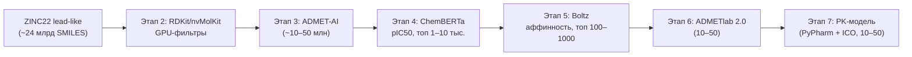

# PharmProject — конвейер поиска кандидатов в лекарства

Вычислительная воронка, которая проводит молекулы от десятков миллиардов «lead-like»
соединений из базы **ZINC22** до нескольких десятков перспективных кандидатов. Для каждого
финального кандидата проект выдаёт предсказание активности (**pIC50**), профиль безопасности
(**ADMET**) и фармакокинетическую модель (**PK**).

> **Статус:** все 7 этапов реализованы и покрыты тестами. Готов к запуску на Linux + NVIDIA GPU
> (см. «Боевой запуск» ниже).

---

## Что делает проект

Проект автоматизирует полный цикл виртуального скрининга лекарств — от сырой химической базы
до короткого списка соединений, готовых к экспериментальной проверке:

1. Скачивает «lead-like» подмножество из ZINC22.
2. Отсеивает заведомо неподходящие молекулы по физико-химическим свойствам.
3. Фильтрует по предсказанным ADMET-свойствам (ADMET-AI).
4. Предсказывает активность (pIC50) дообученной моделью ChemBERTa.
5. Оценивает связывание с мишенью с помощью Boltz.
6. Делает финальную ADMET-оценку через ADMETlab 2.0.
7. Строит трёхкамерную фармакокинетическую модель и подбирает дозирование.

Идея — «воронка» (funnel): каждый этап отбрасывает большую часть молекул, поэтому на каждом
следующем шаге можно позволить себе всё более дорогой и точный метод.

## Полная воронка

| Этап | Что делаем | Вход | Выход | Инструмент |
| :--- | :--- | :--- | :--- | :--- |
| 1 | Скачиваем lead-like | — | ~24 млрд SMILES | ZINC22 |
| 2 | Быстрый отсев по свойствам | ~24 млрд | 1–3 млрд | RDKit (CPU) / nvMolKit (GPU) |
| 3 | ADMET-фильтрация | 1–3 млрд | ~10–50 млн | ADMET-AI |
| 4 | Предсказание pIC50 | ~10–50 млн | топ 1 000–10 000 | ChemBERTa (дообученная на BindingDB) |
| 5 | Докинг / аффинность | 1 000–10 000 | топ 100–1 000 | Boltz |
| 6 | Финальный ADMET | 100–1 000 | 10–50 | ADMETlab 2.0 |
| 7 | PK-модель + дозирование | 10–50 | PK-модели | PyPharm + KrasheMit (ICO) |



## Технологический стек

- **Python 3.11+** — основной язык.
- **RDKit** (CPU) + **nvMolKit** (NVIDIA, GPU) — дескрипторы и фильтры (этап 2).
- **ADMET-AI** (Chemprop v2) — предсказание 104 ADMET-параметров (этап 3).
- **ChemBERTa** (HuggingFace Transformers + PyTorch) — дообучение на BindingDB, pIC50 (этап 4).
- **Boltz** — предсказание комплекса «белок–лиганд» и аффинности (этап 5, GPU).
- **ADMETlab 2.0** — веб-сервис финальной ADMET-оценки (этап 6).
- **PyPharm** — трёхкамерная PK-модель; **KrasheMit (ICO)** — оптимизация дозирования (этап 7).
- **PyArrow (Parquet)** — промежуточные данные; **Pydantic v2** — конфиг и модели.
- **SciPy** — ОДУ; **pytest** — тесты.

## Целевой белок

По умолчанию — **InhA** (еноил-ACP-редуктаза *Mycobacterium tuberculosis*, UniProt **P9WGR1**) —
валидированная мишень противотуберкулёзных препаратов (изониазид). Мишень задаётся в конфигурации
и может быть заменена: другая мишень по имени/UniProt ID либо собственная структура (PDB) или
последовательность. Пороги фильтров настраиваются в конфиге.

## Структура репозитория

```
PharmProject/
├── README.md
├── AGENTS.md                 # контекст и соглашения для дальнейшей работы
├── pyproject.toml
├── requirements.txt          # зависимости
├── config/
│   ├── config.example.yaml   # пример конфига (dev)
│   └── config.prod.yaml      # боевой конфиг (Linux + GPU)
├── src/pharmproject/
│   ├── cli.py                # python -m pharmproject <stage> [--resume] [--config PATH]
│   ├── config.py             # Pydantic-модели конфигурации
│   ├── pipeline/             # Stage, runner, реестр стадий
│   ├── storage/              # пути data/, Parquet-шарды, чекпоинты
│   ├── chemistry/            # дескрипторы и фильтры
│   ├── adapters/             # ZINC22, ADMET-AI, ChemBERTa, Boltz, ADMETlab, KrasheMit
│   ├── stages/               # stage1..stage7
│   ├── models/chemberta/     # BindingDB + дообучение
│   └── pk/                   # трёхкамерная PK-модель + дозирование
├── scripts/
│   ├── setup_prod.sh         # установка на сервере
│   ├── run_funnel.sh         # запуск всей воронки
│   ├── finetune_chemberta.py # дообучение ChemBERTa
│   └── build_ico.py          # сборка C++-модуля ICO (опционально)
├── tests/
└── data/                     # gitignored: raw / intermediate / artifacts
```

## Архитектура (кратко)

Проект — **конвейер стадий** вокруг единой модели данных `MoleculeRecord`. Каждая стадия читает
Parquet-шарды предыдущей, обогащает запись новыми полями (дескрипторы → ADMET → pIC50 → аффинность
→ PK) и пишет результат в `data/`. Ключевые принципы: единый интерфейс стадий, внешние инструменты
за адаптерами, потоковая обработка пошардово, чекпоинты (`--resume`), конфигурация вместо хардкода.
Подробности — в [`AGENTS.md`](AGENTS.md).

---

# Боевой запуск (Linux + 2× NVIDIA A100)

Ниже — пошаговое руководство первого боевого прогона.

## 0. Требования к машине

| Ресурс | Требование |
| :--- | :--- |
| ОС | Linux x86_64 (Ubuntu 22.04+ или аналогичный) |
| GPU | 2× NVIDIA A100 (80 ГБ), драйвер CUDA 12.x (`nvidia-smi` должен работать) |
| CPU/ОЗУ | 32+ ядра, 128+ ГБ ОЗУ (для шардирования и сортировки) |
| Диск | 1–2 ТБ свободного места (ZINC22 + промежуточные Parquet + веса моделей) |
| Python | 3.11 или 3.12 |
| Сеть | доступ к `files.docking.org`, `pypi.org`, `huggingface.co`, `bindingdb.org`, `admetmesh.scbdd.com` |

Проверка GPU:

```bash
nvidia-smi                                  # должно быть 2× A100
python -c 'import torch; print(torch.cuda.is_available(), torch.cuda.device_count())'
# ожидается: True 2
```

## 1. Установка

```bash
git clone https://github.com/Krash13/PharmProject.git && cd PharmProject

# Быстрый путь — один скрипт (ставит всё, включая Boltz и pypharm/krashemit):
bash scripts/setup_prod.sh

# Или вручную (важен порядок и --no-deps):
python3.11 -m venv .venv
source .venv/bin/activate
pip install --upgrade pip

# 1) ядро + Boltz ОДНОЙ командой (резолвер видит все зависимости сразу):
pip install -r requirements.txt -e . "boltz[cuda]"

# 2) KrasheMit и PyPharm с --no-deps:
#    их пин scipy<=1.13.0 конфликтует с Boltz (scipy==1.13.1), поэтому ставим
#    без учёта их зависимостей (сами зависимости уже в requirements.txt)
pip install --no-deps "git+https://github.com/Krash13/KrasheMit.git@testing"
pip install --no-deps "git+https://github.com/Krash13/PyPharm.git"

# 3) nvMolKit НЕ ставим: он требует rdkit<=2026.03.5, а Boltz — rdkit==2026.03.6
#    (через cuik-molmaker-pin). Вместе несовместимы; этап 2 работает на RDKit (CPU).
```

> **C++-модуль `krashemit.ico`** собирается автоматически при `pip install krashemit` (если на
> машине есть C++-компилятор и pybind11). Если не собрался — оптимизатор ICO автоматически
> использует Python-версию KrasheMit (`ico.backend=python` в логах).

## 2. Конфигурация

```bash
cp config/config.prod.yaml config/config.yaml
```

Отредактируйте `config/config.yaml`:

1. **`data_dir`** — путь к данным на сервере (например `/data/pharmproject`).
2. **`target.sequence`** — **обязательно для этапа 5 (Boltz)**. Вставьте аминокислотную
   последовательность InhA. Её можно взять так:
   ```bash
   curl https://www.uniprot.org/uniprot/P9WGR1.fasta
   ```
   (в конфиге — только сама последовательность, без заголовка `>`).
3. При необходимости — пороги фильтров в `stage3.filters`, `stage6.filters`, `thresholds`.

## 3. Подготовка: BindingDB + дообучение ChemBERTa (один раз, до воронки)

Этап 4 требует дообученную ChemBERTa. Сначала качаем BindingDB и обучаем:

```bash
# полное дообучение на всех соединениях InhA из BindingDB (на GPU):
python scripts/finetune_chemberta.py --config config/config.yaml --device cuda

# ИЛИ сначала быстрая проверка на маленькой выборке (500 соединений, 2 эпохи):
python scripts/finetune_chemberta.py --config config/config.yaml --device cuda --max-samples 500 --epochs 2
```

Результат — чекпоинт в `data/artifacts/chemberta_InhA/final/`. Путь к нему уже прописан в
`stage4.checkpoint_path` (`artifacts/chemberta_InhA`).

## 4. Запуск воронки

```bash
# вся воронка одной командой:
bash scripts/run_funnel.sh config/config.yaml

# или поэтапно (полезно для контроля):
python -m pharmproject stage1 --config config/config.yaml --resume
python -m pharmproject stage2 --config config/config.yaml --resume
python -m pharmproject stage3 --config config/config.yaml --resume
python -m pharmproject stage4 --config config/config.yaml --resume
python -m pharmproject stage5 --config config/config.yaml --resume
python -m pharmproject stage6 --config config/config.yaml --resume
python -m pharmproject stage7 --config config/config.yaml --resume
```

Каждая стадия пишет Parquet-шарды в свою директорию и `progress.json` (чекпоинт). `--resume`
пропускает уже обработанные шарды — можно безопасно перезапускать после сбоя.

## 5. Что происходит на каждом этапе и где результат

| Этап | Выход | Что проверять |
| :--- | :--- | :--- |
| 1 | `data/raw/zinc22/shards/*.parquet` + `downloads/` | кол-во скачанных tranche, `progress.json` |
| 2 | `data/intermediate/stage2_filtered/*.parquet` | `stats.kept/filtered` в логах |
| 3 | `data/intermediate/stage3_admet/*.parquet` | колонка `admet` (JSON 104 параметра) |
| 4 | `data/intermediate/stage4_scored/*.parquet` | колонка `pic50`, топ-N |
| 5 | `data/intermediate/stage5_boltz/*.parquet` | `affinity_pred_value`, `affinity_probability_binary` |
| 6 | `data/intermediate/stage6_final_admet/*.parquet` | колонка `admetlab` (JSON) |
| 7 | `data/intermediate/stage7_pk/*.parquet` | `pk_params`, `pk_curve`, `pk_dose`, `pk_tau` |

Логи пишутся через structlog в stdout: `stageN.done` со счётчиками
(`kept / filtered / failed / invalid / skipped`).

## 6. Перезапуск и чекпоинты

- Все стадии идемпотентны. После прерывания перезапустите с `--resume` — обработанные шарды
  пропустятся.
- **Важно для этапов 4 и 5:** топ-N собирается по всем обработанным шардам. При `--resume`
  пропущенные шарды не перечитываются, поэтому топ-N в возобновлённом прогоне считается только
  по новым шардам. Для корректного топ-N после сбоя на этапе 4/5 — запустите этот этап заново
  **без** `--resume`.

## 7. Известные ограничения текущей версии

- **Этап 2 (nvMolKit).** Сейчас дескрипторы считаются на **RDKit (CPU)**. GPU-ускорение **nvMolKit**
  в текущем окружении **недоступно**: nvMolKit требует `rdkit<=2026.03.5`, а Boltz — `rdkit==2026.03.6`
  (через `cuik-molmaker-pin`), поэтому вместе они несовместимы. Для первого прогона используйте
  маленькое подмножество tranche в `stage1.manifest_path`; ускорение 24 млрд на GPU — отдельная
  задача (потребует отдельного окружения под nvMolKit или согласования версий RDKit).
- **2× A100.** Код использует одну GPU на процесс (по умолчанию `cuda:0`). Для ускорения Boltz
  (этап 5) можно распараллелить вручную: два процесса с `CUDA_VISIBLE_DEVICES=0` и `=1`.
- **Единицы ADMETlab (этап 7).** `CL` берётся как мл/мин/кг, `VDss` — л/кг, `Fu` — %; конверсия
  в л/ч, л и долю делается с весом `stage7.body_weight_kg` (70 кг). Сверьте единицы с выгрузкой
  ADMETlab перед финальным прогоном.
- **Boltz (этап 5)** — самая медленная стадия (~20 сек/молекула на A100). Топ-1000 молекул — это
  несколько часов на одной карте; распараллеливайте на две.

---

## Ссылки

- [ZINC22](https://zinc22.docking.org/) — база соединений.
- [nvMolKit](https://github.com/NVIDIA/nvMolKit) — GPU-ускорение RDKit от NVIDIA.
- [ADMET-AI](https://github.com/swansonk14/admet_ai) — предсказание ADMET (Chemprop v2).
- [ChemBERTa](https://github.com/seyonechithrananda/bert-loves-chemistry) — трансформер для SMILES.
- [BindingDB](https://www.bindingdb.org/) — база биоактивности.
- [Boltz](https://github.com/jwohlwend/boltz) — предсказание комплексов и аффинности.
- [ADMETlab 2.0](https://admetmesh.scbdd.com/) — веб-сервис ADMET-оценки.
- [PyPharm](https://github.com/Krash13/PyPharm) — PK-модели.
- [KrasheMit](https://github.com/Krash13/KrasheMit) — оптимизация (ICO).
