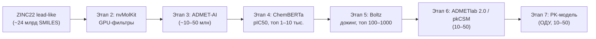

# PharmProject — конвейер поиска кандидатов в лекарства

Вычислительная воронка, которая проводит молекулы от десятков миллиардов «lead-like»
соединений из базы **ZINC22** до нескольких десятков перспективных кандидатов. Для каждого
финального кандидата проект выдаёт предсказание активности (**pIC50**), профиль безопасности
(**ADMET**) и фармакокинетическую модель (**PK**).

> **Статус:** проектирование. Код ещё не написан. В этом репозитории зафиксированы назначение
> проекта, архитектура и план работ. Реализация добавляется поэтапно (см. «Дорожная карта»).

---

## Что делает проект

Проект автоматизирует полный цикл виртуального скрининга лекарств — от сырой химической базы
до короткого списка соединений, готовых к экспериментальной проверке:

1. Скачивает «lead-like» подмножество из ZINC22.
2. Быстро отсеивает заведомо неподходящие молекулы на GPU.
3. Фильтрует по предсказанным ADMET-свойствам.
4. Предсказывает активность (pIC50) дообученной моделью ChemBERTa.
5. Оценивает связывание с мишенью с помощью Boltz.
6. Делает детальную ADMET-оценку для лучших кандидатов.
7. Строит трёхкамерную фармакокинетическую модель.

Идея — «воронка» (funnel): каждый этап отбрасывает большую часть молекул, поэтому на каждом
следующем шаге можно позволить себе всё более дорогой и точный метод.

## Полная воронка

| Этап | Что делаем | Вход | Выход | Инструмент |
| :--- | :--- | :--- | :--- | :--- |
| 1 | Скачиваем lead-like | — | ~24 млрд SMILES | ZINC22 |
| 2 | Быстрый отсев по физико-химическим свойствам | ~24 млрд | 1–3 млрд | nvMolKit (GPU) |
| 3 | ADMET-фильтрация | 1–3 млрд | ~10–50 млн | ADMET-AI |
| 4 | Предсказание активности (pIC50) | ~10–50 млн | топ 1 000–10 000 | ChemBERTa (дообученная на BindingDB) |
| 5 | Докинг / предсказание комплекса | 1 000–10 000 | топ 100–1 000 | Boltz |
| 6 | Финальный ADMET | 100–1 000 | 10–50 | ADMETlab 2.0 / pkCSM |
| 7 | Фармакокинетическое моделирование | 10–50 | PK-модели | Python (SciPy, ОДУ) |



## Технологический стек

- **Python 3.10+** — основной язык.
- **RDKit + nvMolKit (NVIDIA)** — расчёт дескрипторов и фильтры на GPU.
- **ADMET-AI** — открытая модель предсказания 41 ADMET-параметра.
- **ChemBERTa** (HuggingFace Transformers + PyTorch) — дообучение на BindingDB и предсказание pIC50.
- **Boltz** — предсказание структуры комплекса «белок–лиганд» и оценка связывания.
- **ADMETlab 2.0 / pkCSM** — веб-сервисы глубокой ADMET-оценки.
- **SciPy** (`solve_ivp`) — численное решение ОДУ трёхкамерной PK-модели.
- **Polars / DuckDB / PyArrow (Parquet)** — работа с большими таблицами и промежуточными данными.
- **Pydantic v2** — конфигурация и модели данных.
- **pytest** — тесты; **MLflow / Weights & Biases** — трекинг экспериментов (опционально).

## Целевой белок

По умолчанию — **InhA** (еноил-ACP-редуктаза *Mycobacterium tuberculosis*, UniProt **P9WGR1**) —
валидированная мишень противотуберкулёзных препаратов (изониазид). Мишень задаётся в конфигурации
и может быть заменена: другая мишень по имени/UniProt ID либо собственная структура (PDB) или
последовательность. Пороги фильтров этапов 2–4 настраиваются при запуске (конфиг + флаги CLI).

## Структура репозитория (план)

```
PharmProject/
├── README.md                 # этот файл
├── AGENTS.md                 # контекст и соглашения для дальнейшей работы
├── pyproject.toml            # зависимости и метаданные пакета
├── config/                   # YAML-конфиги стадий и общий конфиг
├── src/
│   └── pharmproject/
│       ├── cli.py            # точка входа: python -m pharmproject run <stage>
│       ├── config.py         # загрузка и валидация конфигурации
│       ├── schemas.py        # MoleculeRecord, Candidate и другие модели данных
│       ├── pipeline/         # базовые классы Stage/Pipeline, runner, реестр
│       ├── storage/          # пути data/, чтение/запись Parquet, чекпоинты
│       ├── chemistry/        # дескрипторы и правила-фильтры (обёртки над RDKit/nvMolKit)
│       ├── adapters/         # изоляция внешних инструментов (ZINC22, ADMET-AI, Boltz, ...)
│       ├── stages/           # реализация этапов 1–7
│       ├── models/           # ML-код: дообучение/инференс ChemBERTa, ADMET-AI
│       └── pk/               # трёхкамерная PK-модель и расчёт микроконстант
├── tests/                    # pytest
├── notebooks/                # исследовательские ноутбуки
├── scripts/                  # вспомогательные скрипты (например, загрузка BindingDB)
└── data/                     # данные (gitignored): raw / intermediate / artifacts
```

## Архитектура (кратко)

Проект построен как **конвейер стадий** (pipeline of stages) вокруг единого «контракта данных» —
модели `MoleculeRecord`. Каждая стадия читает вывод предыдущей, обогащает запись новыми полями
(дескрипторы → ADMET → pIC50 → оценка докинга → PK) и пишет результат в Parquet-шарды в
версионированную директорию `data/`.

Ключевые принципы:

- **Один интерфейс стадий** (`Stage.run(context, input) -> output`) — этапы взаимозаменяемы и
  тестируемы независимо.
- **Внешние инструменты за адаптерами** — nvMolKit, ADMET-AI, ChemBERTa, Boltz и веб-сервисы
  изолированы за узкими интерфейсами, их легко заменить или мокировать в тестах.
- **Потоковая обработка и шардирование** — на первых этапах данные измеряются миллиардами,
  поэтому всё читается/пишется пошардово, ничего не держится целиком в памяти.
- **Чекпоинты и возобновляемость** — каждая стадия идемпотентна: при сбое многочасового
  GPU-расчёта она продолжается с места остановки, а не с нуля.
- **Конфигурация вместо хардкода** — мишень, пороги фильтров, пути и веса моделей задаются в YAML.

Подробное описание архитектуры, модели данных и соглашений — в [`AGENTS.md`](AGENTS.md).

## Дорожная карта

- [ ] Этап 1 — загрузка lead-like подмножества ZINC22
- [ ] Этап 2 — быстрый отсев на GPU (nvMolKit)
- [ ] Этап 3 — ADMET-фильтрация (ADMET-AI)
- [ ] Этап 4 — дообучение ChemBERTa на BindingDB + предсказание pIC50
- [ ] Этап 5 — докинг (Boltz)
- [ ] Этап 6 — финальный ADMET (ADMETlab 2.0 / pkCSM)
- [ ] Этап 7 — фармакокинетическое моделирование (ОДУ)
- [ ] Инфраструктура: конфиг, хранение, чекпоинты, трекинг, тесты

## Быстрый старт (план)

Будет оформлен после реализации первых стадий. Ожидаемый сценарий:

```bash
# 1. окружение
python -m venv .venv
pip install -e ".[dev]"

# 2. конфигурация
cp config/config.example.yaml config/config.yaml
#    указать мишень (target, по умолчанию InhA), пути, веса моделей, пороги

# 3. запуск всей воронки или отдельной стадии
python -m pharmproject run all
python -m pharmproject run stage4 --resume
```

## Ссылки

- [ZINC22](https://zinc22.docking.org/) — база коммерчески доступных соединений.
- [nvMolKit](https://github.com/NVIDIA/nvMolKit) — GPU-ускорение RDKit от NVIDIA.
- [ADMET-AI](https://github.com/swansonk14/admet_ai) — предсказание 41 ADMET-параметра.
- [ChemBERTa](https://github.com/seyonechithrananda/bert-loves-chemistry) — трансформер для SMILES.
- [BindingDB](https://www.bindingdb.org/) — база экспериментальной биоактивности.
- [Boltz](https://github.com/jwohlwend/boltz) — предсказание структуры комплексов белок–лиганд.
- [ADMETlab 2.0](https://admetmesh.scbdd.com/) и [pkCSM](https://biosig.lab.uq.edu.au/pkcsm/) —
  веб-сервисы глубокой ADMET-оценки.
